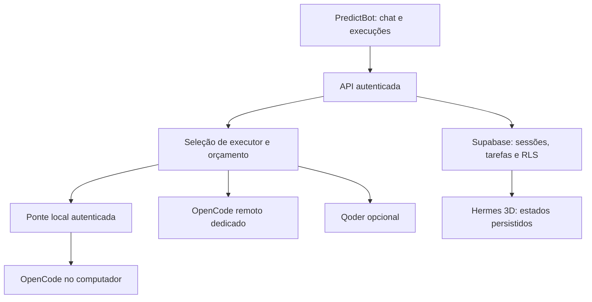

# W1 Capital — correções e integração OpenCode por MCP

Data: 17/11/2026. Escopo: auditoria dirigida do código e implementação do primeiro módulo funcional. Este documento distingue código inspecionado, funcionalidade testada e arquitetura proposta. Não é uma certificação integral de todos os produtos.

## 1. Resumo executivo

A melhor arquitetura mantém INFINITUM como CRM, LexisPredict como produto jurídico, PredictBot como central de agentes e Central de Apps como distribuição desktop. OpenCode é um executor opcional, não um provedor de inferência ilimitada.

O repositório PredictBot tinha somente um README. Portanto, a migração anterior dos agentes para um aplicativo independente não estava concretizada nesse repositório. Este lote cria o módulo OpenCode e sua ponte MCP, com testes de protocolo e conexão real contra OpenCode 2.3.0. A Central recebe controles locais de conexão e tarefas. A migração dos agentes, Hermes 3D e os serviços de nuvem permanecem etapas separadas.

## 2. Estado dos repositórios inspecionados

| Projeto | Evidência no início | Diagnóstico |
| --- | --- | --- |
| W1CAPITAL/Infinitum | `4b25d19`, Next 15.5.29, Electron e Supabase | CRM existente; `/agentes` continua renderizando `AgentsCommandCenter` dentro do CRM |
| W1CAPITAL/PredictBot | Apenas `README.md` de 12 bytes | Não havia aplicativo independente ou executor implementado |
| W1CAPITAL/Central-de-Apps | Electron 45.3.2, dois produtos locais | Launcher independente existente; catálogo e workflow ainda apontavam o INFINITUM para ProjectW1SC |
| W1CAPITAL/LexisPredict | `839b292`, Next 15.5.23, Vitest | Produto existente; commit recente adiciona standalone e nonce local |
| W1CAPITAL/SITE | `d9ade99`, páginas HTML e `zapfast-mcp/` | Site comercial estático com integração separada; não é backend dos agentes |

A inspeção foi feita diretamente nos repositórios. Não houve alteração no banco, em clientes ou em processos reais. Não foram auditadas individualmente todas as migrations, rotas ou políticas RLS.

## 3. Arquitetura atual

INFINITUM contém componentes e rotas de agentes, autenticação e integrações do CRM. A Central empacota servidores Next standalone e os abre em janelas Electron, preservando contas separadas. A execução local independe da Vercel, mas Supabase, tribunais e provedores externos ainda exigem internet.

## 4. Problemas encontrados e correções

| Prioridade | Evidência | Ação |
| --- | --- | --- |
| P1 | PredictBot não continha implementação | Criado pacote independente de adaptador, runtime e MCP |
| P1 | Workflow e catálogo da Central usavam ProjectW1SC/INFINITUM | Alterados para W1CAPITAL/Infinitum, com regressão |
| P1 | Documentação `/docs/server/` redireciona para V1; OpenCode atual usa contrato diferente | Descoberta do contrato instalado, rotas V1/V2 e capacidades verificadas |
| P1 | OpenCode 2.3.0 real retorna HTML em `/doc` | Fallback para `/openapi.json` quando `/doc` não é JSON |
| P1 | Respostas V2 de sessão usam envelope `data` | Adaptador extrai o registro correto |
| P1 | Prompts repetidos após timeout podem duplicar trabalho/custo | Não há repetição automática de operações de escrita |
| P2 | Migração dos chats/avatares ainda não existe no PredictBot | Planejada migração gradual, preservando histórico e retorno ao CRM |

Não foi demonstrado neste lote que QR Code, WhatsApp, consultas jurídicas ou OAuth do CRM foram corrigidos.

## 5. Funcionalidades aproveitáveis

Reaproveitar o standalone, isolamento de janelas e verificações de assinatura da Central; a autenticação e o controle de empresa do CRM; os conectores jurídicos especializados do LexisPredict. Não copiar banco ou credenciais para o executor. Não copiar PredictLM: o contrato do INFINITUM exige sua API autorizada.

## 6. Qoder Cloud Agents

Foram inspecionados `package.json`, `src/run.ts`, `src/target.ts` e o README do SDK oficial. O plugin tem licença MIT, Node >=22 e acoplamento explícito a vários pacotes DeepSeek Harness. Sua dependência é o alias `qoder-cloud-agents-sdk` para `qca-sdk@0.8.0`.

Aproveitar os conceitos de seleção explícita de ambiente, identificação da sessão, retorno por branch, acompanhamento de eventos e cancelamento. Não importar o plugin inteiro como núcleo do PredictBot. Um adaptador opcional pode usar o SDK oficial, mantendo PAT e token Git no servidor e permissões mínimas. O código inspecionado orienta o executor a trabalhar e publicar somente na branch de resultado. Essa proteção também deve existir no host, não somente no prompt.

O SDK documenta Node 20.12+; o plugin exige Node 22+. São requisitos diferentes. Não foi executada sessão Qoder, consumido crédito ou comprovada disponibilidade de ambiente próprio. BYOC continua exigindo um worker operado por alguém.

## 7. OpenCode: implementação e verificação

`OpenCodeAdapter` permite conexão HTTP autenticada, descoberta de versão/capacidades, modelos/provedores, projeto autorizado, sessões, prompts, mensagens, diff, cancelamento, eventos e gerenciamento MCP V2.

`OpenCodeRuntime` detecta executável por caminho explícito ou PATH, executa somente `--version`, inicia `serve` em `127.0.0.1` com porta disponível e senha aleatória, drena saída sem expor a senha e encerra somente o processo que ele mesmo criou. Também é possível conectar a instância existente pelo endereço e senha fornecidos. Não existe descoberta automática de todas as instâncias em execução.

Testado com binário Linux oficial 2.3.0: saúde autenticada, sessão sintética, recuperação, modelos, provedores, mensagens e estado MCP. A configuração de MCP foi testada adicionando um servidor remoto desabilitado e removendo-o. Isso testa a API de gerenciamento; não prova conexão a um serviço MCP externo.

Não foi enviado prompt real a um modelo: não havia provedor e orçamento de execução configurados para esse teste. O envio foi coberto por teste de contrato, não por inferência ao vivo.

## 8. Arquitetura e contratos MCP

A ponte usa o SDK oficial MCP TypeScript 1.32.2 via STDIO, com schemas Zod. As ferramentas são documentadas no README.

| Escopo | Operações | Fronteira |
| --- | --- | --- |
| read | Saúde, versão, modelos, projeto, sessões, mensagens, diff e MCPs | Apenas sessões criadas pelo adaptador no mesmo contexto local |
| execute | Criar sessão, enviar prompt, interromper | Explicitamente habilitado pelo host; ferramentas negadas na sessão padrão |
| manage | Registrar MCP aprovado | Configuração fornecida pelo operador local, nunca comando recebido do modelo |

A identidade vem da configuração do processo local. O registro persistido é particionado por usuário, empresa, diretório e servidor. O cliente MCP não escolhe empresa por argumento. Isso é isolamento do aplicativo local, não uma autenticação multiempresa para internet. A senha do servidor OpenCode continua sendo uma credencial ampla; não compartilhar uma única instância entre empresas mutuamente não confiáveis.

O transporte HTTP público não foi implementado. Ele precisa de OAuth, validação de audience, escopos, resolução de tenant no servidor e proteção de origem antes da publicação.

## 9. Arquitetura proposta do PredictBot

O diagrama representa o destino arquitetural. Neste lote, adaptador, runtime e ponte STDIO foram implementados; API de orquestração, roteador e ponte remota ainda precisam ser construídos.

A interface comum deve declarar capacidades e implementar `health`, `listModels`, `createSession`, `sendPrompt`, `streamEvents`, `getSession`, `getDiff`, `cancel` e `getUsage` quando o provedor realmente as oferecer. Recursos indisponíveis retornam erro explícito. Não migrar uma sessão entre provedores sem resumo, anexos autorizados e indicação da perda de contexto.

## 10. Hermes 3D e PredictLM

Hermes deve consumir eventos persistidos de execução, como aguardando, iniciado, solicitando aprovação, concluído, interrompido e falhou. Não derivar trabalho de timers decorativos. O adaptador oferece SSE filtrado pela sessão; a Central consulta mensagens reais a cada cinco segundos. Persistência remota de eventos e reconciliação de eventos perdidos ainda não existem.

PredictLM deve ser um provedor autorizado separado, com contexto e métricas; histórico salvo não equivale a treino ou autoaprendizagem. Melhorias de comportamento devem passar por avaliações e revisão de alterações.

## 11. n8n

Usar opcionalmente para gatilhos e workflows externos. Não é requisito para enviar uma tarefa ao OpenCode. Instalar n8n em algum lugar não cria hospedagem gratuita permanente. Não foi instalado ou executado neste lote; sua licença e o uso comercial pretendido precisam ser revisados antes de redistribuição.

## 12. INFINITUM

Preservar clientes, processos, atendimento e dados operacionais. Migrar agentes em etapas: primeiro API de sessões autenticada, depois chats e histórico, então redirect com contexto para o PredictBot. A Central já consegue ser a superfície comum sem exigir desmontar o CRM.

O CRM não foi alterado neste lote. Seu AGENTS.md exige testes, typecheck, DOM, build e Docker quando suas superfícies mudam; essas verificações não foram declaradas como executadas para código não alterado.

## 13. Launcher e loja

A Central recebe conexão local/remota, detecção de versão, sessões, tarefas, respostas, diff, interrupção e gerenciamento MCP. O endereço e a senha são tratados no processo principal; a senha é limpa da interface após conectar e não é gravada em JSONC ou armazenamento do navegador. A conexão deve ser refeita ao reiniciar.

O instalador existente só publica atualização automática após Authenticode válido. Isso pode bloquear releases na ausência de certificado; não foi removido ou contornado. Assinatura Ed25519, digest e Authenticode têm papéis diferentes e não devem ser apresentados como equivalentes.

Não foi produzido ou instalado um novo EXE neste ambiente Linux. O workflow Windows valida o empacotamento após a publicação da proposta. Uma PR não significa atualização já entregue ao computador.

## 14. Infraestrutura e OpenCode local remoto

Para conectar PredictBot na nuvem ao PC, usar conexão de saída autenticada iniciada pela Central. Pareamento precisa expirar, vincular usuário/empresa/dispositivo, admitir revogação e validar cada job. O broker deve ter lease, heartbeat, idempotência, limite de concorrência, expiração e cancelamento. Se o PC desligar, mostrar indisponível e manter o job na fila, sem simular execução.

Supabase pode guardar registros/RLS; Cloudflare pode oferecer broker/WebSocket, sujeito a quotas. A mensagem recebida não pode conter comando de shell arbitrário: deve indicar operação tipada autorizada. Não abrir a porta do OpenCode na internet. Essa ponte remota é desenho, não foi implantada.

## 15. Segurança

Bloqueados HTTP fora de loopback, credenciais em URLs, redirecionamento de requisições autenticadas para outras origens, sessões desconhecidas e configuração MCP com segredos literais. Respostas JSON possuem limite; requisições possuem timeout e escritas não são repetidas automaticamente. Logs contêm operação, status e tempo, sem prompt, resposta ou senha.

Não há credenciais Supabase, PAT, service_role ou tokens embutidos. Não houve mudança em RLS. Sessões locais restritas negam ferramentas; modo de revisão depende da aprovação nativa do OpenCode. A UI não oferece aprovação automática.

A ponte não é sandbox do sistema operacional. Uma aprovação nativa de ferramenta pode permitir operações com o acesso da conta do Windows. Projetos sensíveis devem usar checkout separado e credenciais mínimas.

## 16. Custos

| Alternativa | Custo e limite real |
| --- | --- |
| OpenCode local + provedor | Orquestração local; inferência segue cobrança/quota do provedor configurado |
| OpenCode remoto próprio | Precisa de máquina e disponibilidade; não existe hospedagem ilimitada garantida |
| Supabase/Cloudflare | Dependem das quotas e plano da conta; não foram alterados ou contratados |
| GitHub Actions/Releases | Usam quotas e políticas da conta; Windows pode consumir tempo de execução |
| Qoder Cloud | Requer conta, credenciais e controle de consumo; desabilitado neste lote |
| n8n | Software, operação, licença e hospedagem devem ser avaliados separadamente |

Nenhum serviço pago foi contratado e nenhuma sessão de IA paga foi iniciada.

## 17. Comparativo das alternativas

| Opção | Melhor uso | Limitação |
| --- | --- | --- |
| OpenCode local | Baixo custo operacional com provedores existentes | PC precisa estar ligado |
| OpenCode remoto | Executor disponível sem depender do PC | Infraestrutura própria e autenticação |
| Qoder | Sandboxes gerenciados e branches de resultado | Consumo e dependência externa |
| PredictLM | Inteligência e roteamento autorizados | Integração contratual separada |
| n8n | Eventos e workflows | Não substitui executor nem inferência |

## 18. Roadmap priorizado e ordem ideal

1. P1: revisar e integrar as propostas deste lote; gerar artefato Windows e testar no PC.
2. P1: configurar um provedor no OpenCode e executar tarefa sintética com orçamento definido.
3. P1: API PredictBot autenticada, escopos e RLS próprios para tarefas/sessões.
4. P1: ponte de saída com pareamento, revogação e isolamento por dispositivo.
5. P2: migrar chats e agentes do INFINITUM preservando histórico e links.
6. P2: mostrar fila e eventos reais no Hermes 3D.
7. P2: checkouts de trabalho, branches e revisão de diff antes de integrar alterações.
8. P2: estabilidade WhatsApp/QR/histórico em uma frente separada com testes reais autorizados.
9. P3: adaptador Qoder opcional com orçamento e tokens Git mínimos.
10. P3: avaliação de respostas, observabilidade e n8n opcional; P4 para experimentos visuais.

## 19. Plano por lote

| Lote | Arquivos/superfície | Aceitação | Risco e rollback |
| --- | --- | --- | --- |
| A, implementado | PredictBot `src/`, `test/`, CI e documentação | Protocolo, isolamento, contrato e smoke real | Reverter pacote/commit sem tocar no CRM |
| B, implementado | Central `src/`, catálogo, dependência fixada e workflows | UI de conexão, sessões, gerenciamento MCP e testes | Reverter proposta; instalador anterior preservado |
| C, planejado | API PredictBot, migrations aditivas e RLS | Usuário não acessa outra empresa; execução rastreável | Desabilitar provedor/rotas; preservar registros |
| D, planejado | Broker e agente de saída | Pareamento revogável, expiração, reconexão sem repetir tarefa | Revogar dispositivo e pausar fila |
| E, planejado | Chat/Hermes/SDK Qoder | Histórico recuperado e eventos verdadeiros | Feature flag e retorno ao fluxo existente |

## 20. Alterações concretas

PredictBot: pacote independente, contrato HTTP por versão, runtime local seguro, CLI MCP STDIO, schemas/escopos, registro privado de sessões, eventos e smoke test reproduzível.

Central: controlador IPC confiável, interface de conexão e gerenciamento de tarefas/MCP, importação fixada do pacote PredictBot e correção das fontes INFINITUM para W1CAPITAL. Nenhuma reconstrução visual do CRM, migration de produção, merge ou deploy foi feito.

## 21. Testes e critérios de aceitação

Resultados finais são registrados na descrição das PRs. A suíte cobre entradas inválidas, sessão desconhecida, isolamento persistido de empresa, redirect com Basic Auth, ausência de capacidade, negociação MCP, schemas e filtragem SSE. Testes de contrato não são apresentados como execução de modelo.

O smoke real usa projeto temporário e não envia prompt. Para aceite completo no Windows: conectar binário instalado, verificar sessão existente, enviar tarefa sintética com provedor configurado, observar pedido nativo de aprovação, cancelar, reiniciar a Central e recuperar a sessão. Depois testar empacotamento e assinatura. Isso ainda depende da máquina Windows e das credenciais do provedor.

## 22. Dez melhorias de maior impacto e decisões finais

As dez etapas do roadmap são a ordem recomendada de investimento. A maior oportunidade é uma execução única, rastreável e autorizada compartilhada pelos produtos, mantendo seus domínios separados.

Aproveitar da Qoder seleção de ambiente, sessões e entrega por branch; usar SDK em adaptador opcional. Tornar OpenCode executor pela API autenticada; disponibilizar capacidades por MCP STDIO com escopos e registro de propriedade da sessão. Permitir gerenciar MCPs somente por configuração validada e aprovada. Conectar nuvem ao PC por saída autenticada com pareamento, jamais por exposição de localhost. Reduzir custo reutilizando provedores e serviços existentes, com quotas e sem repetição de tarefas. Agentes trabalham juntos quando delegações, estado, contexto e aprovações são registrados, não por avatares ou texto de prompt isolados.

### Referências primárias consultadas

- https://opencode.ai/docs/api
- https://opencode.ai/docs/openapi.json
- https://opencode.ai/docs/mcp-servers/
- https://opencode.ai/docs/migrate-v1
- https://opencode.ai/docs/build/client/
- https://opencode.ai/docs/
- https://modelcontextprotocol.io/docs/develop/build-server
- https://github.com/QoderAI/dsh-qoder-cloud-agents
- https://github.com/QoderAI/qoder-cloud-agents-sdk-ts
